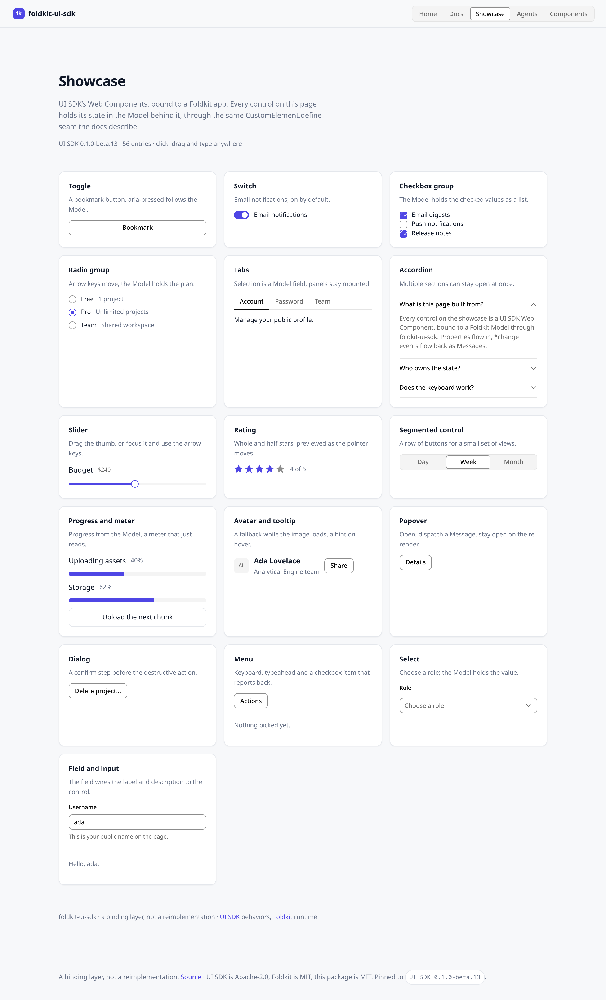

# foldkit-ui-sdk

UI SDK's behaviors and components as typed [Foldkit](https://foldkit.dev) bindings.

[UI SDK](https://ui-sdk.dev) ships 51 components — menus, listboxes, dialogs, calendars, drag
and drop, trees, carousels and the rest — with keyboard, focus, selection, dismissal and ARIA
tested through `@ui-sdk/core/testing`, plus an agent bridge in `@ui-sdk/core/agent`. Foldkit's
`@foldkit/ui` covers the common TEA-native components. This package puts all 361 UI SDK tags,
across 56 entries, inside a Foldkit app, with the same shape they have in React, Vue, Svelte,
Solid and Web Components.



That screenshot is the Showcase page of [examples/site](examples/site), the marketing, docs
and showcase app — styled with UI SDK's own Web Components stylesheet.

It does that through the seam both projects already support: UI SDK's Web Components, bound to
Foldkit with `CustomElement.define`. Properties flow from the Model into the element; UI SDK's
`*change` events come back as Messages. No primitive store lives in your Model, and no Foldkit
state lives in the element.

## Install

```bash
pnpm add foldkit-ui-sdk foldkit effect @effect/platform-browser
```

`foldkit` and `effect` are peer dependencies. Use a bundler that compiles TypeScript
dependencies, like Vite, the same requirement UI SDK's own packages have.

## Quick start

```ts
import { Schema } from 'effect'
import { type Document, type HtmlBuilder } from 'foldkit/html'
import { defineMessageUnion } from 'foldkit/message'

// Registers <ui-toggle> only. The root entry registers everything.
import { Toggle } from 'foldkit-ui-sdk/toggle'

const Message = defineMessageUnion({
  ChangedBookmarked: { bookmarked: Schema.Boolean },
})
type Message = typeof Message.Type

export const view = (
  model: { bookmarked: boolean },
  h: HtmlBuilder<Message>
): Document => {
  const toggle = Toggle.Root.withMessage(h)

  return {
    title: 'Bookmark',
    body: toggle(
      [
        toggle.Pressed(model.bookmarked),
        toggle.OnPressedchange(detail =>
          Message.ChangedBookmarked({ bookmarked: detail.value })
        ),
      ],
      [h.button([h.Type('button')], ['Bookmark'])]
    ),
  }
}
```

The namespace is the component, and every part is named the way UI SDK names it across
frameworks: `Root`, `List`, `Tab`, `Panel`, `Trigger`, `Content`, `Item`, and so on. Each part
is a `CustomElementSpec`; `.withMessage(h)` binds its events to the current Message universe.

| UI SDK React / Vue / Solid | This package |
| --- | --- |
| `Tabs`, `TabsList`, `TabsTab` | `Tabs.Root`, `Tabs.List`, `Tabs.Tab` |
| `open` + `onOpenChange` | `Popover.Root.Open(...)` + `Popover.Root.OnOpenchange(...)` |
| `defaultValue` | `Tabs.Root.DefaultValue(...)` |
| `<Slider value={[25]}>` | `Slider.Root.Value([25])` |

Change events decode to `{ value, reason, source }`, so reasons and analytics work the same as
in the other adapters.

## Imports

| Import | Registers | Use |
| --- | --- | --- |
| `foldkit-ui-sdk/toggle` | That component's tags | Normal apps. One import per component |
| `foldkit-ui-sdk` | Every tag | Prototypes, docs, examples |

The full list, with each entry's spec names, is in [docs/components.md](docs/components.md).

## Goodies that come with it

The package is a binding layer, not a reimplementation, so UI SDK's framework-agnostic tools
work unchanged on the rendered page:

- **`foldkit-ui-sdk/testing`** (UI SDK's `checkPattern`, `settle` and part readers) checks a
  rendered component against its WAI-ARIA pattern, in right-to-left and on the server.
- **`foldkit-ui-sdk/agent`** (`createAgent`, then its `snapshot` and `act`) reads and operates
  the same markup, so an agent can drive the interface.
- **`foldkit-ui-sdk/observe`** and **`foldkit-ui-sdk/shortcuts`** are the page observation and
  shortcut managers, unchanged.
- **Controllers** are on each element (`el.api`), for programmatic open, focus, selection and
  the rest.

## What this is not

Foldkit's view is a pure `Model -> Document` function, and every event dispatches a Message.
UI SDK's primitives are an external store that binds to elements and writes attributes, ids and
top-layer state directly. A native Foldkit renderer would have to recreate a component-instance
model, and its keyboard, focus and pointer work would lose the synchronous DOM event. The Web
Components boundary is the architecture-respecting way to combine them, and it is what Foldkit
recommends for declarative third-party elements.

Two limits follow from that boundary:

- **No server-rendered ARIA.** UI SDK's Web Components calculate state in the browser. A
  Foldkit SSR page renders the tags without `aria-expanded`, `aria-selected` and friends until
  the elements upgrade. UI SDK documents the same limitation for its Web Components.
- **No cancellation from the view.** `CustomElement.define` gives an event factory the decoded
  `detail`, not the event, so a Foldkit view cannot `preventDefault()` a change to refuse it.
  Controlled properties still win on the next render; the difference is that the element applies
  the change before Foldkit writes it back.

## Development

```bash
pnpm install
pnpm run generate        # regenerate src/entries from @ui-sdk/web/custom-elements.json
pnpm run check:generated # fail if the bindings are stale
pnpm run typecheck
pnpm test                # every tag has a binding, events, properties, namespaces
pnpm run test:e2e        # Playwright on the examples
pnpm run screenshot      # recapture docs/screenshot.png from the site's showcase page
```

The example app runs with Vite:

| Example | Port | What it is |
| --- | --- | --- |
| [examples/site](examples/site) | 5197 | The marketing, docs and showcase site — built with the bindings it documents: per-component pages that run their component live, a sixteen-demo showcase, a 145-tile Sink, and a live agent-bridge demo (`pnpm run dev`) |

The **Sink** is a 1:1 port of [ui-sdk.dev/sink](https://ui-sdk.dev/sink): the same 145 tiles, copy,
sizes, tones, bento CSS and floating filter, rendered with `foldkit-ui-sdk` bindings instead of
React. Filter by the component names a tile uses (`?only=`, `?uses=`, `?mode=all`), or read how it
is wired and what the port surfaced in [docs/sink.md](docs/sink.md).

See [docs/architecture.md](docs/architecture.md) for how the generator and the binding layer fit
together.

## Credits

- [UI SDK](https://github.com/vercel-labs/ui) (Apache-2.0) owns the behaviors, components and
  Web Components. This package only binds them.
- [Foldkit](https://github.com/foldkit/foldkit) (MIT) owns the runtime and `CustomElement`.
- `foldkit-ui-sdk` itself is MIT.
